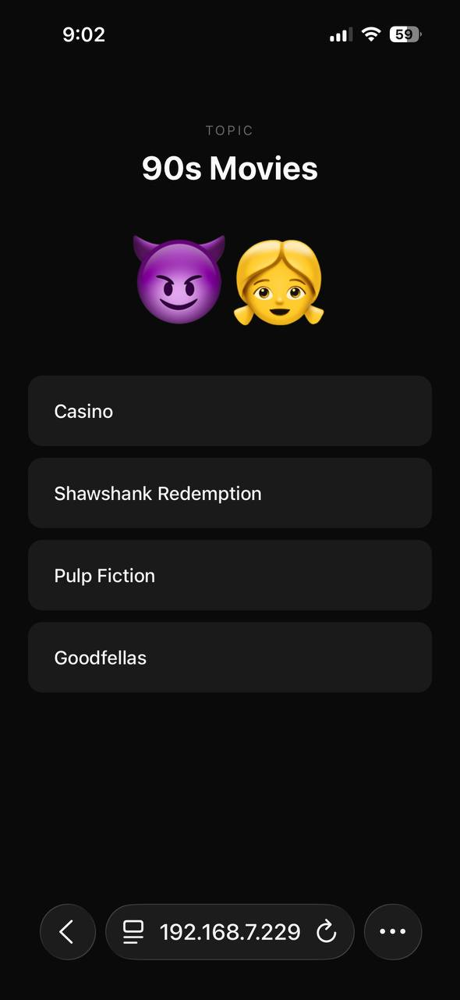
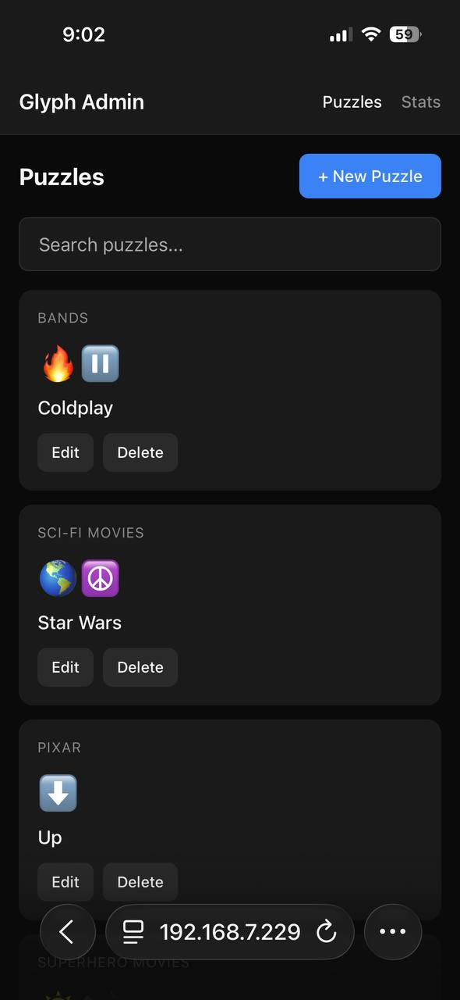

# Glyph

**Think opposite.**

A puzzle game where you decode emoji clues by thinking in opposites. Each emoji represents a word — find the opposite, and you'll find the answer.

<p align="center">
  
  
</p>

## How It Works

1. See the **topic** (your hint)
2. See the **emoji clues**
3. Think of the **opposite** of each emoji
4. Pick the answer that fits

## Tech Stack

- **Frontend:** Vanilla HTML/CSS/JS
- **Backend:** Node.js
- **Database:** Firebase Firestore

## Getting Started

```bash
# Install dependencies
npm install

# Add Firebase credentials
# Download service account JSON from Firebase Console
# Save as serviceAccount.json in project root

# Run dev server
npm run dev
```

Open [http://localhost:4747](http://localhost:4747) to play.

Open [http://localhost:4747/admin](http://localhost:4747/admin) to create puzzles.

## Project Structure

```
glyph/
├── src/
│   ├── game/       # Player-facing game UI
│   ├── admin/      # Puzzle creator UI
│   ├── api/        # Backend API
│   └── db/         # Firebase integration
├── scripts/        # Dev server
└── screenshots/    # App screenshots
```

## License

MIT
